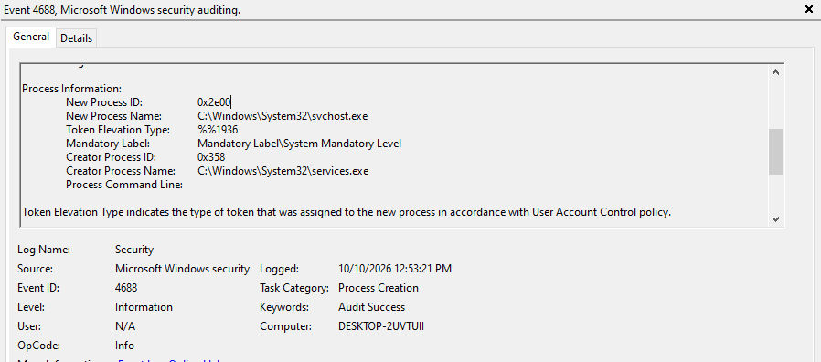
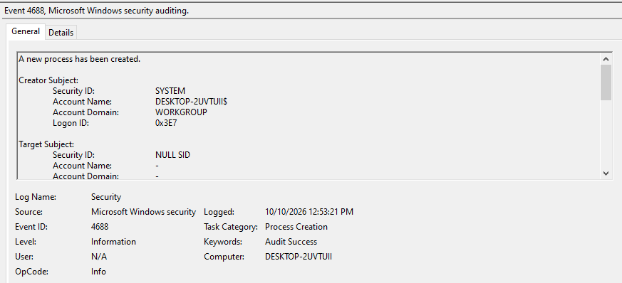

# Lab 01: Windows Process Creation Auditing (Event ID 4688)

<div class="lab-meta" markdown>
**Category:** Endpoint Telemetry and Baselining<br>
**ATT&CK:** [T1059 Command and Scripting Interpreter](https://attack.mitre.org/techniques/T1059/) | [T1204.002 User Execution: Malicious File](https://attack.mitre.org/techniques/T1204/002/)<br>
**Tools:** Local Security Policy, Windows Event Viewer<br>
**Host:** Windows 10/11 lab workstation (`DESKTOP-2UVTUII`)
</div>

!!! success "Verdict: Benign | Baseline established"
    The process captured (`services.exe` launching `svchost.exe` as SYSTEM) is normal Windows service startup. The value of this lab is the baseline and the detection logic it produced.

---

## 1. Objective

Attackers lean on built-in Windows binaries to run commands, enumerate the host, and launch payloads. Windows does not log process creation by default, so without it a SOC is blind to most of that activity.

The goal: turn on process creation auditing, generate telemetry, and learn to read **Event ID 4688** for parent-child process lineage.

---

## 2. Configuration

1. Opened `secpol.msc` and went to **Advanced Audit Policy Configuration > System Audit Policies > Detailed Tracking**.
2. Enabled **Audit Process Creation** for Success and Failure.
3. Filtered the Security log in Event Viewer to Event ID `4688`.

!!! warning "Gap found: command lines are off by default"
    4688 only records the binary name unless you also enable **Administrative Templates > System > Audit Process Creation > Include command line in process creation events**. Without it you can see `powershell.exe` ran, but not the encoded payload it ran. This is the first setting I'd check in any new environment.

---

## 3. Evidence

### Filtered Security log



### A single 4688 event



| Field | Value | Meaning |
|---|---|---|
| Event ID | `4688` | A new process was created |
| Creator account | `SYSTEM` (`DESKTOP-2UVTUII$`) | Launched by the OS itself |
| New process | `C:\Windows\System32\svchost.exe` | The child |
| Creator process | `C:\Windows\System32\services.exe` | The parent |
| Mandatory label | System Mandatory Level | Highest integrity |

---

## 4. Analysis

Process lineage is the core of endpoint triage. The question is never just "what ran" but "what launched it".

| Parent | Child | Read |
|---|---|---|
| `services.exe` | `svchost.exe` | Normal. This is how Windows starts services |
| `explorer.exe` | `chrome.exe` | Normal. User opened a browser |
| `winword.exe` | `powershell.exe` | **Malicious until proven otherwise.** Classic macro execution |
| `excel.exe` | `cmd.exe` | **Malicious until proven otherwise.** Same pattern |
| `wmiprvse.exe` | `powershell.exe` | **Suspicious.** Common in remote WMI execution |

---

## 5. Detection Logic

Office applications should almost never start a shell. This SPL flags it from Windows Security logs:

```spl
index=wineventlog EventCode=4688
| eval parent=lower(Creator_Process_Name), child=lower(New_Process_Name)
| where match(parent, "\\\\(winword|excel|powerpnt|outlook|onenote)\.exe$")
    AND match(child, "\\\\(cmd|powershell|pwsh|wscript|cscript|mshta|rundll32|regsvr32)\.exe$")
| table _time host Account_Name parent child Process_Command_Line
```

!!! info "Status"
    Logic only. Next step is to trigger it with an Atomic Red Team macro test and record the results here.

---

## 6. Takeaways

- **Know the baseline first.** `svchost.exe` is normal. `svchost.exe` launched by anything other than `services.exe` is not.
- **Enable command line logging.** Process names without arguments leave the most important evidence out.
- **Sysmon Event ID 1 is the upgrade.** It adds hashes, parent command lines, and process GUIDs, which is what [Lab 03](lab-03-splunk-lsass.md) relies on.
