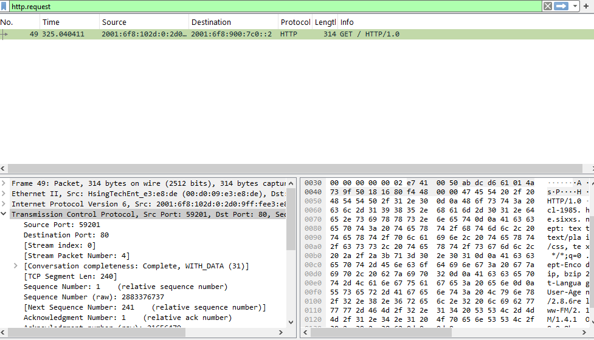
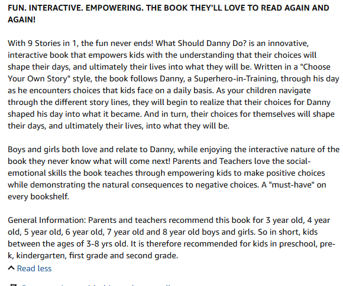

# Lab 02: Network Traffic Analysis and HTTP Stream Reconstruction

<div class="lab-meta" markdown>
**Category:** Network Forensics<br>
**ATT&CK:** [T1071.001 Application Layer Protocol: Web Protocols](https://attack.mitre.org/techniques/T1071/001/) | TA0011 Command and Control<br>
**Tools:** Wireshark (Protocol Hierarchy, Endpoints, Follow TCP Stream)<br>
**Evidence:** [`http.cap`](https://github.com/DesiKick/soc-analyst-portfolio/blob/main/evidence/lab-02/http.cap) (public Wireshark sample capture)
</div>

!!! warning "Verdict: Benign in this capture | Pattern worth alerting on"
    The session is a terminal browser pulling a public directory listing. Nothing malicious was downloaded, but cleartext HTTP from a non-standard client is exactly what C2 and scripted downloads look like on the wire.


!!! abstract "In plain English"
    **What this is:** A network recording (a PCAP) is like a transcript of every conversation computers had over the network. I replayed one conversation between a computer and a web server.

    **Why it matters:** When a hacked computer contacts its attacker, the network recording often shows it, even if the attacker wiped the logs on the computer itself.

    **What I did:** Filtered the recording down to just the web requests, rebuilt the full back-and-forth conversation, and identified the unusual program that made the request.

    **Result:** This traffic was harmless: a text-only web browser downloading a public file list. I documented the pattern worth alerting on, which is unencrypted web traffic from programs that are not normal browsers.

**Skills this lab shows:** `Wireshark` `Packet analysis` `HTTP` `IPv6` `Client fingerprinting`

??? info "Key terms in this lab"
    - **PCAP:** a recording of network traffic
    - **HTTP vs HTTPS:** unencrypted vs encrypted web traffic
    - **User-Agent:** the label a program uses to identify itself to a website
    - **C2:** the channel an attacker uses to control a hacked computer

    Every term is explained in the [Glossary](../foundations/glossary.md).

---

## 1. Objective

When endpoint logs are missing or wiped, packets are still the source of truth. The goal: triage a capture, isolate application-layer requests, rebuild the full session, and pull out the artifacts an analyst would put in a ticket.

---

## 2. Method

1. **Scoped the capture.** Used **Statistics > Protocol Hierarchy** for the protocol mix and **Statistics > Endpoints (IPv6)** for who talked to whom.
2. **Filtered to requests.** Applied `http.request` to drop transport noise and keep only client-initiated web requests.
3. **Rebuilt the session.** Used **Follow > TCP Stream** to read the request and response as one conversation.

Useful filters for this kind of triage:

```text
http.request                              # client requests only
http.request and !(http.user_agent contains "Mozilla")   # non-browser clients
http.response.code >= 400                 # errors and blocked requests
tcp.port == 80 and ip.src == <internal>   # cleartext traffic leaving a host
```

---

## 3. Evidence

### HTTP requests isolated



### Reconstructed TCP stream



| Artifact | Value |
|---|---|
| Frame | `49` |
| Client | `2001:6f8:102d:0:2d0:9ff:fee3:e8de` (source port `59201`) |
| Server | `2001:6f8:900:7c0::2` port `80` |
| Host header | `cl-1985.ham-01.de.sixxs.net` |
| User-Agent | `Lynx/2.8.6rel.2 libwww-FM/2.14 SSL-MM/1.4.1 OpenSSL/0.9.8b` |
| Response | `HTTP/1.1 200 OK` from Apache, open directory listing |

---

## 4. Analysis

- **Everything is readable.** Over port 80 with no TLS, the headers, client identity, and full response are exposed. Any credentials sent here would be too.
- **The client is not a normal browser.** `Lynx` is a terminal browser. On a corporate workstation, a non-standard User-Agent usually means a script, a tool, or something running without a user at the keyboard.
- **Open directory listing.** The server exposed `.pdf` and `.htm` files. In a real case I'd carve anything downloaded with **File > Export Objects > HTTP**, hash it, and check the hash against threat intel.

---

## 5. Detection Logic

Cleartext outbound HTTP from workstations with an unusual User-Agent, using proxy or Zeek-style HTTP logs:

```spl
index=proxy dest_port=80
| where NOT match(http_user_agent, "(?i)(mozilla|windows-update|microsoft)")
| stats count values(url) as urls dc(dest) as destinations by src http_user_agent
| where count > 5
```

!!! info "Status"
    Logic only. Next step is to run it against a capture with real beaconing (planned for Lab 07).

---

## 6. Takeaways

- **Port 80 leaving a workstation is worth a look.** Almost all legitimate web traffic is TLS now.
- **User-Agent is cheap context.** It's not proof, since attackers can fake it, but an odd one is a fast way to prioritize.
- **Follow the stream.** Single packets are fragments. The stream is what goes in the report.
