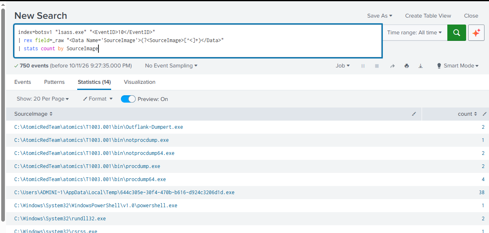

# Lab 03: Threat Hunting LSASS Credential Dumping in Splunk

<div class="lab-meta" markdown>
**Category:** SIEM Threat Hunting and Detection Engineering<br>
**ATT&CK:** [T1003.001 OS Credential Dumping: LSASS Memory](https://attack.mitre.org/techniques/T1003/001/) | TA0006 Credential Access<br>
**Tools:** Splunk Enterprise, SPL, Sysmon (Event IDs 1, 10, 11)<br>
**Evidence:** [`windows-sysmon.log`](https://github.com/DesiKick/soc-analyst-portfolio/blob/main/evidence/lab-03/windows-sysmon.log) (7,974 events) | **Detection:** [`detections/`](https://github.com/DesiKick/soc-analyst-portfolio/tree/main/detections)
</div>

!!! danger "Verdict: True Positive | Critical | Escalate to IR"
    Two domain controllers had LSASS memory dumped with six different methods, including a renamed binary built to evade name-based detection. Domain credentials should be treated as compromised.

---

## 1. Objective

`lsass.exe` holds credentials, Kerberos tickets, and NTLM hashes in memory. Dumping it is how attackers move from one compromised host to the whole domain.

The goal: ingest raw Sysmon telemetry into Splunk, separate attack activity from normal system noise, rebuild the attack timeline, and ship a detection that does not depend on tool names.

---

## 2. Data Source

| Field | Value |
|---|---|
| Telemetry | Sysmon Operational log, raw XML |
| Key events | 10 ProcessAccess, 1 ProcessCreate, 11 FileCreate |
| Hosts | `win-dc-807.attackrange.local`, `win-dc-262.attackrange.local` |
| Event time range | 2020-11-03 to 2021-02-03 (UTC) |
| Adversary simulation | Atomic Red Team T1003.001, run in Splunk Attack Range |

!!! note "Index name"
    I loaded the log into a local Splunk index named `botsv1`. The data itself is Attack Range telemetry, not the BOTS v1 dataset.

---

## 3. Hunt Methodology

### Step 1: Broad sweep

Every event mentioning LSASS, as source or target:

```spl
index=botsv1 "lsass.exe"
```


**Result:** 851 events. Too broad to triage, since LSASS also appears as the *source* of normal activity.

### Step 2: Extract fields from raw XML

The log was ingested as raw XML with no field parsing, so I extracted `SourceImage` with `rex` and narrowed to Event ID 10:

```spl
index=botsv1 "lsass.exe" "<EventID>10</EventID>"
| rex field=_raw "<Data Name='SourceImage'>(?<SourceImage>[^<]+)</Data>"
| stats count by SourceImage
```



**Result:** 750 events from 14 source processes. Atomic Red Team binaries stand out immediately, but this view still mixes in normal Windows processes.

### Step 3: Isolate who opened LSASS, and with what rights

Event ID 10 records the access mask (`GrantedAccess`). Reading LSASS memory requires `PROCESS_VM_READ` (0x0010), so masks like `0x1fffff` (full access) and `0x1410` are what dumping looks like. Routine system access is usually `0x1400` or `0x1000`.

```spl
index=botsv1 "<EventID>10</EventID>"
| rex field=_raw "<Data Name='SourceImage'>(?<SourceImage>[^<]+)</Data>"
| rex field=_raw "<Data Name='TargetImage'>(?<TargetImage>[^<]+)</Data>"
| rex field=_raw "<Data Name='GrantedAccess'>(?<GrantedAccess>[^<]+)</Data>"
| where match(TargetImage, "(?i)\\\\lsass\.exe$")
| stats count by SourceImage GrantedAccess
| sort - count
```

**Result:** 163 processes opened LSASS directly. 108 were normal Windows processes with low access masks. 55 were not.

| Stage | Events | What changed |
|---|---|---|
| Keyword sweep | 851 | Any event mentioning `lsass.exe` |
| Event ID 10 only | 750 | Process access events, LSASS as source or target |
| LSASS as target | 163 | Something opened LSASS |
| Benign baseline | 108 | `svchost`, `wininit`, `csrss`, `services` with low access masks |
| **Alerts** | **55** | Non-system processes with memory-read access |

### Step 4: Pivot to process creation and file events

Event ID 10 shows *who* touched LSASS but not the command line. To confirm intent I pivoted to Event ID 1 (process creation) and Event ID 11 (file creation), looking for the command lines and the dump files they wrote.

```spl
index=botsv1 ("<EventID>1</EventID>" OR "<EventID>11</EventID>")
  ("lsass" OR "comsvcs" OR "mimikatz" OR ".dmp")
| rex field=_raw "<Data Name='CommandLine'>(?<CommandLine>[^<]+)</Data>"
| rex field=_raw "<Data Name='TargetFilename'>(?<TargetFilename>[^<]+)</Data>"
| table _raw CommandLine TargetFilename
```

---

## 4. Findings

### Processes that read LSASS memory

| Source Process | Access | Count | Host | Assessment |
|---|---|---|---|---|
| `AppData\Local\Temp\644c305e-...d1d.exe` | `0x1fffff` | 38 | dc-807 | **Malicious.** Dropped by `wce.exe` (Windows Credentials Editor) and run as a SYSTEM service by `services.exe` |
| `procdump.exe` / `procdump64.exe` | `0x1fffff` | 6 | both | **Malicious.** `procdump -ma lsass.exe` wrote `lsass_dump.dmp` |
| `notprocdump.exe` / `notprocdump64.exe` | `0x1fffff` | 3 | dc-262 | **Malicious.** Renamed ProcDump to evade name-based rules |
| `Outflank-Dumpert.exe` | `0x1fffff` | 2 | dc-807 | **Malicious.** Direct syscall dumper, wrote `dumpert.dmp` |
| `rundll32.exe` | `0x1fffff`, `0x1410` | 2 | dc-807 | **Malicious.** `comsvcs.dll MiniDump`, a living-off-the-land dump |
| `taskmgr.exe` | `0x1fffff`, `0x1410` | 3 | dc-262 | **Suspicious.** Interactive admin session created `lsass (2).DMP` from Task Manager |
| `powershell.exe` | `0x1410` | 1 | dc-807 | **Needs context.** Occurred 1 second after LSASS started at boot, before the attack chain |

### Dump files written to disk (Event ID 11)

| Time (UTC) | Host | Writer | File |
|---|---|---|---|
| 2020-11-03 15:52:59 | dc-807 | `procdump64.exe` | `C:\Windows\Temp\lsass_dump.dmp` |
| 2020-11-03 15:53:03 | dc-807 | `rundll32.exe` | `...\AppData\Local\Temp\lsass-comsvcs.dmp` |
| 2020-11-03 15:53:03 | dc-807 | `Outflank-Dumpert.exe` | `C:\Windows\Temp\dumpert.dmp` |
| 2021-02-03 16:51:01 | dc-262 | `procdump64.exe` | `C:\Windows\Temp\lsass_dump.dmp` |
| 2021-02-03 16:51:14 | dc-262 | `notprocdump64.exe` | `C:\Windows\Temp\lsass_dump.dmp` |
| 2021-02-03 21:34:57 | dc-262 | `taskmgr.exe` | `...\AppData\Local\Temp\2\lsass (2).DMP` |

### Attack timeline: win-dc-807, 2020-11-03 (UTC)

| Time | Activity |
|---|---|
| 15:52:48 | PowerShell checks that dumping tools exist on disk (`Test-Path ...\procdump.exe`, `mimikatz.exe`) |
| 15:52:58 | `wce.exe` drops a GUID-named binary to Temp, which runs as a SYSTEM service and opens LSASS 38 times |
| 15:52:59 | `procdump -accepteula -ma lsass.exe` writes a full memory dump |
| 15:53:03 | `rundll32 comsvcs.dll MiniDump` and `Outflank-Dumpert.exe` each write a dump |
| 15:53:03 | `mimikatz.exe "sekurlsa::minidump %tmp%\lsass.DMP" "sekurlsa::logonpasswords full"` parses a dump offline |
| 15:53:06 | Cleanup: `del lsass_dump.dmp`, `del dumpert.dmp`, `Remove-Item lsass-comsvcs.dmp` |

**Key observation:** Mimikatz never touched live LSASS. It parsed a dump file offline, so it does not appear in Event ID 10 at all. Only process creation logging (Event ID 1) caught it. A detection built only on Event ID 10 would miss this step.

### Indicators

| Type | Value |
|---|---|
| SHA256 | `7234C8F98B87593641BBDB594E34C94B9436986C4FB70E7DA5BCECFF147D14C3` (Temp service binary) |
| MD5 | `605560CA0624AABF9F53675257B9BE21` |
| File path | `C:\Users\ADMINI~1\AppData\Local\Temp\644c305e-30f4-470b-b616-d924c3206d1d.exe` |
| Tool directory | `C:\AtomicRedTeam\atomics\T1003.001\bin\` |
| Dump files | `lsass_dump.dmp`, `lsass-comsvcs.dmp`, `dumpert.dmp`, `lsass (2).DMP` |
| Account | `ATTACKRANGE\Administrator` |

---

## 5. Detection Rule

Built to catch the behavior, not the tool name: any non-system process opening LSASS with memory-read rights.

```spl
index=botsv1 "<EventID>10</EventID>"
| rex field=_raw "<Data Name='SourceImage'>(?<SourceImage>[^<]+)</Data>"
| rex field=_raw "<Data Name='TargetImage'>(?<TargetImage>[^<]+)</Data>"
| rex field=_raw "<Data Name='GrantedAccess'>(?<GrantedAccess>[^<]+)</Data>"
| rex field=_raw "<Computer>(?<host_name>[^<]+)</Computer>"
| where match(TargetImage, "(?i)\\\\lsass\.exe$")
| where match(GrantedAccess, "(?i)^0x(1fffff|1010|1410|1438|143a|1f3fff)$")
| where NOT match(SourceImage, "(?i)^C:\\\\Windows\\\\System32\\\\(svchost|wininit|csrss|services|lsm)\.exe$")
| eval severity=if(match(SourceImage, "(?i)\\\\(AppData|Temp|Users\\\\Public)\\\\"), "critical", "high")
| stats count min(_time) as first_seen max(_time) as last_seen values(GrantedAccess) as access by host_name SourceImage severity
| sort - count
```

### Validation against the lab data

| Metric | Result |
|---|---|
| LSASS access events evaluated | 163 |
| Alerts fired | 55 |
| Alerts tied to confirmed dumping | 54 |
| Alerts needing analyst context | 1 (PowerShell at boot) |
| Benign system accesses alerted | 0 of 108 |
| Renamed `notprocdump.exe` caught | Yes, matched on behavior, not name |

A [Sigma version](../detections.md) is in the detection library for porting to other SIEMs.

---

## 6. Takeaways

1. **Detect the access mask, not the filename.** `notprocdump.exe` would slip past a rule looking for "procdump". It cannot hide its `0x1fffff` request to LSASS.
2. **Event ID 10 alone is not enough.** Offline parsing with Mimikatz only shows up in process creation logs. Pair access monitoring with command line monitoring for `sekurlsa`, `MiniDump`, and `-ma lsass`.
3. **Watch for dump files.** An Event ID 11 rule for `*.dmp` files containing "lsass" is a cheap second layer that caught every dump here, including the Task Manager one.
4. **Check your timestamps.** Splunk set `_time` to my ingest time because the raw XML was not timestamp-parsed. The real event times came from the `SystemTime` field. In production, configure `TIME_PREFIX` in `props.conf` so timelines are correct.

---

## 7. Response Actions

- Isolate `win-dc-807` and `win-dc-262` from the network.
- Reset passwords for every account with an active session on both hosts, starting with `ATTACKRANGE\Administrator`.
- Reset the `krbtgt` account twice to invalidate forged Kerberos tickets.
- Hunt for the SHA256 above and for `*.dmp` files across all endpoints.
- Enable LSA Protection (`RunAsPPL`) and Credential Guard on domain controllers.
