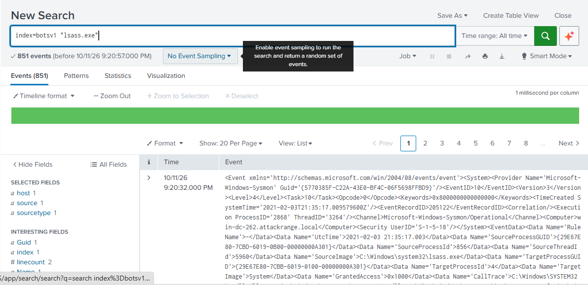

# Lab 03: SIEM Threat Hunting & LSASS Credential Dumping Detection

- **Date:** October 2026
- **Category:** SIEM Detection Engineering & Threat Hunting
- **Framework Mapping:** MITRE ATT&CK [T1003.001 - OS Credential Dumping: LSASS Memory] / [TA0006 - Credential Access]
- **Tooling:** Splunk Enterprise, Search Processing Language (SPL), Sysmon (Event ID 10)

---

## 1. Executive Summary & Objective
Local Security Authority Subsystem Service (`lsass.exe`) enforces security policy and stores active authentication credentials, Kerberos tickets, and NTLM hashes in process memory. Adversaries routinely target LSASS to harvest credentials for domain-wide lateral movement.

The objective of this investigation was to ingest high-fidelity endpoint security telemetry into Splunk, build regular expression field extractions against raw Sysmon XML, and engineer a robust detection query (SPL) that exposes unauthorized attempts to access and dump LSASS memory.

---

## 2. Telemetry & Attack Surface
- **Data Source:** Sysmon Operational Logs (`Microsoft-Windows-Sysmon`)
- **Event ID:** `10` (ProcessAccess)
- **Target Process:** `C:\Windows\System32\lsass.exe`
- **Simulated Adversary:** Atomic Red Team (`T1003.001`)

---

## 3. Threat Hunting & SPL Engineering

### Phase 1: Ingestion & Telemetry Exploration
An initial hunt query across the dedicated `botsv1` index isolated all events referencing the LSASS credential vault:

index=botsv1 "lsass.exe"

The search isolated 851 raw sysmon records detailing process access attempts against the local authority service

---
### Phase 2: SPL Field Extraction & Aggregation
Because the raw log payload contained nested XML attributes without native schema parsing, a targeted regular expression (rex) query was constructed to extract the requesting binary (SourceImage) and aggregate execution frequency:

index=botsv1 "lsass.exe" "<EventID>10</EventID>"
| rex field=_raw "<Data Name="SourceImage">(?<SourceImage>[^<]+)</Data>"
| stats count by SourceImage

! [Credential Dumping Artifacts Table](../assets/image/lab03-splunk-table.png)
## 4. Forensic Findings & Malicious Artifacts Identified

The analytical query exposed multiple adversary tools accessing LSASS:

| Requesting Image (`SourceImage`) | Invocations | Threat Classification |
| :--- | :--- | :--- |
| `Outflank-Dumpert.exe` | 2 | Custom Red-Team LSASS Memory Dumper |
| `procdump.exe` / `procdump64.exe` | 6 | Weaponized Sysinternals Dump Utility |
| `notprocdump.exe` | 1 | Defense Evasion (Renamed Binary) |
| `AppData\Local\Temp\*.exe` | 38 | Dropped Binary from Temp Directory |
| `powershell.exe` | 1 | Scripted Credential Ingestion (`Invoke-Mimikatz`) |
| `rundll32.exe` | 2 | LOLBin (`comsvcs.dll` MiniDump execution) |

---

## 5. SOC Detection Engineering Takeaways
1. **Filename-Agnostic Rules:** Attackers frequently disguise binaries (evidenced by `notprocdump.exe`). Detections should alert on the **TargetImage** (`lsass.exe`) combined with abnormal **GrantedAccess** permissions (e.g., `0x1010`, `0x1F0FFF`), rather than relying solely on the process filename.
2. **Untrusted Path Baselines:** Any process originating from `AppData\Local\Temp` or non-standard paths that accesses `lsass.exe` represents high-confidence malicious behavior and should generate immediate Priority-1 alerts in the SOC.