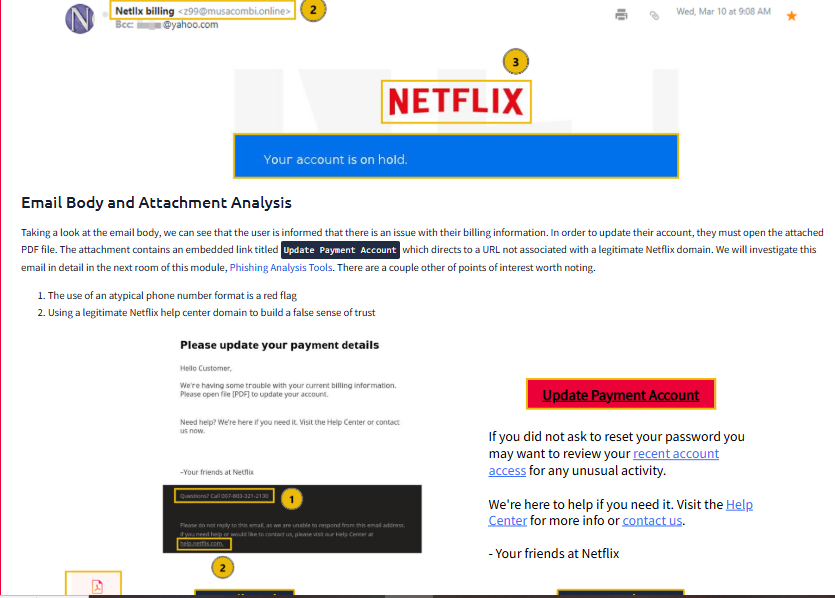

# Lab 04: Inbound Phishing Analysis and Header Forensics

<div class="lab-meta" markdown>
**Category:** Phishing Triage<br>
**ATT&CK:** [T1566.001 Spearphishing Attachment](https://attack.mitre.org/techniques/T1566/001/) | [T1566.002 Spearphishing Link](https://attack.mitre.org/techniques/T1566/002/) | TA0001 Initial Access<br>
**Tools:** Raw header analysis (RFC 5322), CyberChef, URL defanging, static document review<br>
**Samples:** TryHackMe Phishing Analysis module (training samples, analysis and write-up are my own)
</div>

!!! danger "Verdict: All samples malicious | Block, purge, and hunt for clicks"
    Every sample impersonated a known brand and either harvested credentials or delivered a payload. None should reach a user inbox.


!!! abstract "In plain English"
    **What this is:** Phishing emails pretend to come from trusted brands to trick people into giving up passwords or opening malware. I analyzed real phishing samples from a training set.

    **Why it matters:** Most breaches start with an email. Catching a phishing campaign early, and finding everyone who clicked, is one of the most common things a SOC does.

    **What I did:** Compared who each email claimed to be from with where it really came from, followed the links through their redirects, examined the attachments, and built a list of indicators to block.

    **Result:** Every sample was malicious. The response plan: remove them from every inbox, block the senders and links, and check whether anyone clicked.

**Skills this lab shows:** `Email header analysis` `SPF / DKIM / DMARC` `URL and redirect analysis` `IOC extraction` `Response planning`

??? info "Key terms in this lab"
    - **Spoofing:** faking the sender of an email
    - **Email header:** the hidden routing details that show where an email really came from
    - **IOC:** a clue such as a bad domain or file name, used for blocking
    - **Defanging:** rewriting a link so it cannot be clicked by accident

    Every term is explained in the [Glossary](../foundations/glossary.md).

---

## 1. Objective

Phishing is still the most common way attackers get in. Modern lures use brand impersonation, lookalike names, and multi-stage redirects to get past email gateways.

The goal: triage reported emails the way a SOC queue would, check headers for sender spoofing, trace links and redirects, review attachments, and produce a clean IOC set for blocking.

---

## 2. Triage Summary

| Sample | Lure | Technique | Verdict | Action |
|---|---|---|---|---|
| PayPal receipt | Fake transaction | Display name spoofing, foreign envelope sender | Malicious | Block sender domain, purge |
| Netflix suspension | Account on hold | Typosquatted display name, PDF with a payment link to a non-Netflix domain | Malicious | Block sender, purge, check for clicks |
| Shared-file lure | Document waiting | URL shortener, tracking pixel, multi-hop redirect to fake Outlook login | Malicious | Block domains, reset any user who clicked |
| Apple billing | Blank body, attachment only | `.dot` template that pulls remote macros | Malicious | Block attachment type, hash hunt |
| DHL delivery | "Enable content" spreadsheet | `.xlsx` lure designed to launch `regasm.exe` | Malicious | Block, hunt for `regasm.exe` from Office |

---

## 3. Investigation

### Phase 1: Headers and sender identity

The display name and the real sending address did not match in either brand-impersonation sample:

- **PayPal:** Displayed `service@paypal.com`, but the envelope sender came from `sultanbogor[.]com`, a domain with no relationship to PayPal.
- **Netflix:** Display name `Netllx billing`, with "fi" swapped for "ll" so it reads as Netflix at a glance. Sent from `z99@musacombi[.]online`. The body pushed an attached PDF whose "Update Payment Account" link pointed to a non-Netflix domain, padded with a real Netflix help link and an odd-format phone number to look legitimate.



Mail clients show the display name prominently and hide the routing path. That gap is what these lures depend on.

**What I check in every header:**

| Header | Why it matters |
|---|---|
| `From` vs `Return-Path` | A mismatch is the fastest spoofing signal |
| `Authentication-Results` | SPF, DKIM, and DMARC pass or fail for the claimed domain |
| `Received` chain (read bottom up) | The true origin server and any odd relays |
| `Reply-To` | Often points to an attacker inbox even when `From` looks clean |

### Phase 2: Links, tracking pixels, and redirects

1. **URL shortener.** Links went through `hxxps://is[.]gd/6oCJ4m` to hide the real landing page from scanners.
2. **Tracking pixel.** A 1x1 image (`tracking.png` on `devret[.]xyz`) told the attacker the mailbox was live and the email was opened.
3. **Redirect chain.** Links bounced through lookalike file-sharing pages (Citrix → OneDrive → Adobe) before landing on a fake Microsoft Outlook login page built to harvest credentials.

### Phase 3: Attachments

When links get blocked, attackers switch to attachments:

- **Apple `.dot` template.** Blank email body, just the attachment. Word templates can fetch macros from a remote server when opened, so the file looks clean until it runs.
- **DHL `.xlsx`.** The spreadsheet told the user to click "Enable Content", the step that lets embedded code run and launch `regasm.exe`, a signed Windows binary attackers abuse to run payloads.

---

## 4. IOCs (defanged)

| Type | Indicator | Context |
|---|---|---|
| Sender domain | `sultanbogor[.]com` | PayPal impersonation |
| Sender address | `z99@musacombi[.]online` | Netflix impersonation |
| Tracking domain | `hxxp://devret[.]xyz` | Tracking pixel host |
| Short link | `hxxps://is[.]gd/6oCJ4m` | Hides credential harvesting page |
| Attachment | `Apple_Receipt.dot` | Remote template macro loader |
| Process | `regasm.exe` launched by Excel | Living-off-the-land execution |

---

## 5. Response and Detection

**Immediate response**

- Purge every sample from all mailboxes, not just the reporter's.
- Block the sender domains, tracking domain, and short link at the gateway and proxy.
- Search proxy logs for anyone who reached the short link or the fake Outlook page. Any hit means a password reset and session revoke for that user.

**Hardening**

1. **Enforce DMARC alignment.** Quarantine or reject mail where the `From` domain fails SPF alignment or has no valid DKIM signature.
2. **Block risky attachment types** from external senders: `.dot`, `.dotm`, `.xltm`, and macro-enabled Office files.
3. **Automate triage.** Have SOAR parse reported `.eml` files, defang links, expand shorteners in a sandbox, and check every domain against threat intel.

**Endpoint detection for the DHL sample**

```spl
index=sysmon EventCode=1
| where match(ParentImage, "(?i)\\\\(excel|winword)\.exe$")
    AND match(Image, "(?i)\\\\regasm\.exe$")
| table _time host User ParentImage Image CommandLine
```
