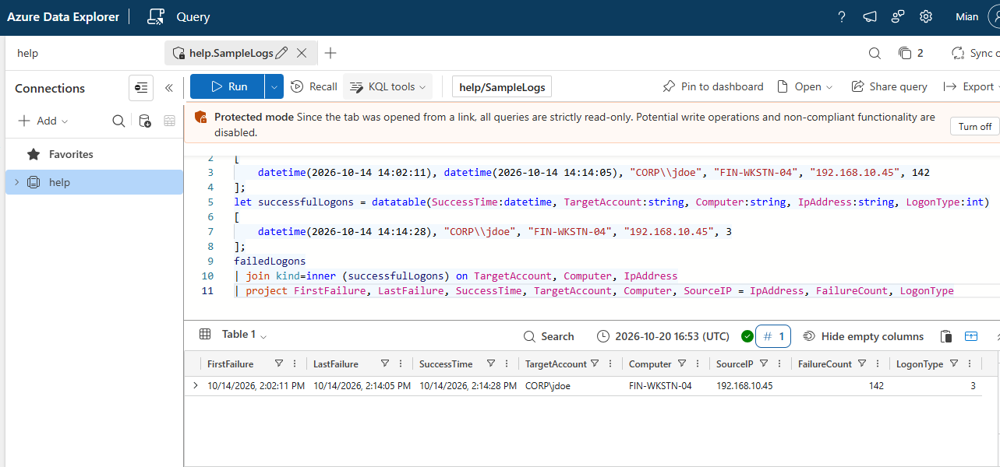
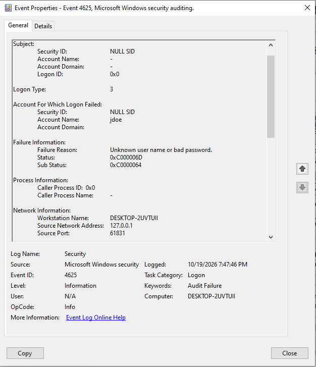

# Lab 05: Brute Force Detection Logic in KQL

<div class="lab-meta" markdown>
**Category:** Identity Detection Engineering<br>
**ATT&CK:** [T1110.001 Password Guessing](https://attack.mitre.org/techniques/T1110/001/) | [T1110.003 Password Spraying](https://attack.mitre.org/techniques/T1110/003/) | [T1033 System Owner/User Discovery](https://attack.mitre.org/techniques/T1033/)<br>
**Query language:** KQL, written for the Microsoft Sentinel `SecurityEvent` table<br>
**Test environments:** Azure Data Explorer (simulated data), my Windows workstation (real 4625 events)
</div>

!!! warning "Simulated scenario: read this first"
    The attack story below (host `FIN-WKSTN-04`, account `CORP\jdoe`, source `192.168.10.45`) is a **scenario I designed** to build and test detection logic. It is not a real incident and no containment took place. The KQL was tested in Azure Data Explorer against a small hand-built dataset, and separately against real failed logons I generated on my own machine. Running it against live Sentinel telemetry is planned as **Lab 05 v2**.


!!! abstract "In plain English"
    **What this is:** Brute force means guessing a password over and over until one works. I wrote search logic that spots many failed logins followed by a successful one from the same place.

    **Why it matters:** One wrong password is normal. Dozens of failures in minutes, then a success, means someone probably guessed their way in.

    **What I did:** Designed an attack scenario, tested the search logic on sample data, then tested it against real failed logins on my own computer. That real test exposed two blind spots, which I fixed.

    **Result:** An improved rule, plus a second rule for password spraying. The next step is running both on a real cloud SIEM with live data.

**Skills this lab shows:** `KQL` `Windows logon events` `Correlation logic` `Detection testing` `Tuning`

??? info "Key terms in this lab"
    - **Brute force:** guessing one account's password repeatedly
    - **Password spraying:** trying a few common passwords across many accounts
    - **KQL:** the search language for Microsoft Sentinel
    - **Event IDs 4625 / 4624:** Windows log entries for a failed and a successful login

    Every term is explained in the [Glossary](../foundations/glossary.md).

---

## 1. Objective

A single failed logon means nothing. Users mistype passwords all day. What matters is **many failures followed by a success** from the same source, because that means the attacker probably got in.

The goal: write KQL that correlates repeated Event ID 4625 failures with a 4624 success, test the logic, and find out where it breaks.

---

## 2. How Windows Records Logons

| Event ID | Meaning | Why it matters here |
| :--- | :--- | :--- |
| **4625** | An account failed to log on | Source IP, target account, logon type, and the failure reason |
| **4624** | An account logged on successfully | Tells you whether the guessing worked |
| **4688** | A new process was created | Shows what the attacker did next, if process auditing is on |

The **SubStatus** field on 4625 tells you *why* the logon failed, and that changes what you are looking at:

| SubStatus | Meaning | What it suggests |
| :--- | :--- | :--- |
| `0xC000006A` | Account exists, wrong password | Password guessing against a real account |
| `0xC0000064` | Account does not exist | Username enumeration, or spraying a list of guessed names |
| `0xC0000072` | Account disabled | Attempts against dormant accounts |
| `0xC0000234` | Account locked out | Lockout policy triggered, often by brute force |

!!! note
    `0xC000006D` usually appears in the **Status** field ("unknown user name or bad password"). The **SubStatus** carries the specific reason. Always read SubStatus.

Logon types matter too: **3** is network (SMB, for example), **10** is RDP, **2** is interactive at the keyboard. See the [Event ID Reference](../foundations/event-reference.md) for the full list.

---

## 3. Scenario Design (simulated)

The scenario I built the rule around:

| Time (UTC) | Event | Detail | Meaning |
| :--- | :--- | :--- | :--- |
| 14:02:11 | 4625 | `CORP\jdoe`, from `192.168.10.45`, Logon Type 3, SubStatus `0xC000006A` | Guessing starts |
| 14:14:05 | 4625 | 142nd failure in 12 minutes | Too fast and too regular for a human |
| 14:14:28 | **4624** | `CORP\jdoe`, from `192.168.10.45`, Logon Type 3 | **The password was guessed** |
| 14:15:10 | 4688 | `whoami /all` run on `FIN-WKSTN-04` under `CORP\jdoe` | Attacker checks who they are and what groups they have (T1033) |

---

## 4. Test 1: Correlation Logic in Azure Data Explorer

I don't have live Sentinel data for this scenario, so I tested the **join logic** in Azure Data Explorer's free query environment. I wrote the two event summaries as a `datatable` and ran the correlation against them.

```kql
let failedLogons = datatable(FirstFailure:datetime, LastFailure:datetime, TargetAccount:string, Computer:string, IpAddress:string, FailureCount:int)
[
    datetime(2026-10-14 14:02:11), datetime(2026-10-14 14:14:05), "CORP\\jdoe", "FIN-WKSTN-04", "192.168.10.45", 142
];
let successfulLogons = datatable(SuccessTime:datetime, TargetAccount:string, Computer:string, IpAddress:string, LogonType:int)
[
    datetime(2026-10-14 14:14:28), "CORP\\jdoe", "FIN-WKSTN-04", "192.168.10.45", 3
];
failedLogons
| join kind=inner (successfulLogons) on TargetAccount, Computer, IpAddress
| project FirstFailure, LastFailure, SuccessTime, TargetAccount, Computer, SourceIP = IpAddress, FailureCount, LogonType
```

<figure markdown>
  
  <figcaption>The join returns one row matching the failures to the success on account, host, and source IP. This proves the join keys and output columns work. It does not prove the thresholds or field formats against real Sentinel data.</figcaption>
</figure>

**What this test proves:** the join keys line up and the output is what an analyst needs.
**What it does not prove:** how the rule behaves on real, messy telemetry. That is what Test 2 is for.

---

## 5. Test 2: Real Failed Logons on My Workstation

Next I generated real failed network logons on my own machine (`DESKTOP-2UVTUII`) against the account name `jdoe`, which does not exist there, and looked at what Windows actually recorded.

<figure markdown>
  
  <figcaption>Real Event ID 4625 from my workstation: Logon Type 3, Status 0xC000006D, SubStatus 0xC0000064 (user does not exist), source network address 127.0.0.1.</figcaption>
</figure>

This real event exposed **two gaps** in my first version of the rule:

| What the real event showed | Problem with version 1 | Fix in version 2 |
| :--- | :--- | :--- |
| SubStatus `0xC0000064`, not `0xC000006A` | v1 only matched wrong-password failures, so attacks against **nonexistent accounts** (enumeration, spraying guessed names) were invisible | Match both SubStatus values |
| Source `127.0.0.1` | v1 excludes loopback, so this local test could never fire | Correct for production, since loopback failures come from local services. For local testing, remove that filter temporarily |

Also, version 1 grouped by **target account**. That catches one account being hammered but misses **password spraying**, where an attacker tries one password across many accounts. Version 2 groups by source IP and host instead and records which accounts were tried.

---

## 6. Detection Rule v2 (Sentinel `SecurityEvent`)

```kql
let lookback = 1h;
let failureThreshold = 10;
let successWindow = 10m;
let failures = SecurityEvent
    | where TimeGenerated > ago(lookback)
    | where EventID == 4625
    | where LogonType in (3, 10)
    | where SubStatus in~ ("0xc000006a", "0xc0000064")
    | where isnotempty(IpAddress) and IpAddress !in ("-", "127.0.0.1", "::1")
    | summarize
        FailureCount = count(),
        FirstFailure = min(TimeGenerated),
        LastFailure = max(TimeGenerated),
        AccountsTried = make_set(TargetUserName, 50)
        by IpAddress, Computer
    | where FailureCount >= failureThreshold;
let successes = SecurityEvent
    | where TimeGenerated > ago(lookback)
    | where EventID == 4624
    | where LogonType in (3, 10)
    | project SuccessTime = TimeGenerated, IpAddress, Computer, SuccessAccount = TargetUserName;
failures
| join kind=inner successes on IpAddress, Computer
| where SuccessTime between (FirstFailure .. (LastFailure + successWindow))
| project FirstFailure, LastFailure, SuccessTime, AttackerIP = IpAddress, VictimHost = Computer,
    SuccessAccount, FailureCount, AccountsTried
| order by SuccessTime desc
```

### Companion rule: password spraying

Spraying looks different: **many accounts, few attempts each**, to stay under lockout thresholds.

```kql
SecurityEvent
| where TimeGenerated > ago(1h)
| where EventID == 4625 and LogonType in (3, 10)
| where isnotempty(IpAddress) and IpAddress !in ("-", "127.0.0.1", "::1")
| summarize Attempts = count(), DistinctAccounts = dcount(TargetUserName),
    Accounts = make_set(TargetUserName, 25) by IpAddress, bin(TimeGenerated, 15m)
| where DistinctAccounts >= 5 and Attempts <= DistinctAccounts * 3
```

!!! info "Validation status"
    Both rules are written for the Sentinel `SecurityEvent` schema. They have **not yet been run against live Sentinel data**. Thresholds (10 failures, 5 accounts) are starting points that would need tuning against a real baseline.

---

## 7. Expected False Positives and Tuning

| Source of noise | Why it fires | How to handle it |
| :--- | :--- | :--- |
| Service account with an expired password | Retries every few seconds, forever | Find and fix the service; allowlist only after fixing |
| User who just changed their password | Phone or mapped drive keeps using the old one | Usually low count, single account; check the device |
| Vulnerability scanners | Authenticated scans try many logons | Allowlist scanner IPs, but alert if they ever **succeed** unexpectedly |
| VPN or NAT gateways | Many users share one source IP | Group by account as well, or exclude the gateway and use VPN logs |

---

## 8. If This Fired for Real: Response Steps

1. **Confirm:** check the 4624 for the logon type, the time gap from the last failure, and whether the source IP is normal for this user.
2. **Scope:** look for other successes from the same IP, and any 4688 process activity under the account after the logon.
3. **Contain:** disable the account or force a password reset, kill active sessions, and isolate the source host if it is internal.
4. **Escalate:** a confirmed guessed password is a true positive at **High** severity. Escalate to IR with the timeline.
5. **Prevent:** enforce MFA, review lockout policy, and block legacy NTLM where possible.

---

## 9. Takeaways

- **Test against real events, not just your assumptions.** One real 4625 from my own machine found two gaps the simulated test never would have.
- **SubStatus changes the story.** `0xC000006A` means a real account is being guessed. `0xC0000064` means someone is guessing names.
- **Group by source to catch spraying.** Grouping by account only catches one account being hammered.
- **Next:** Lab 05 v2 runs these rules against real telemetry from a Windows VM sending logs to a Sentinel workspace.
