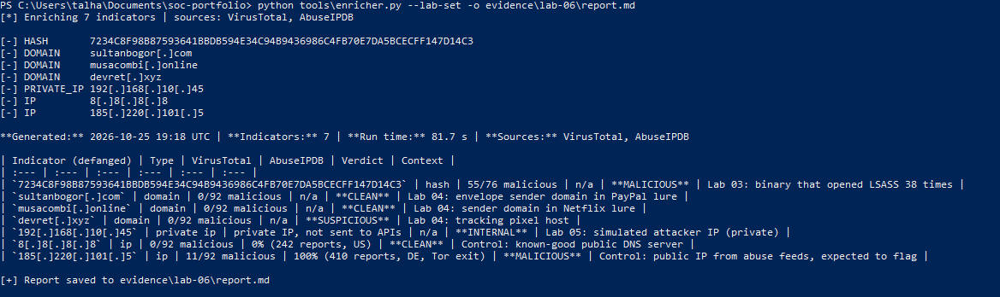
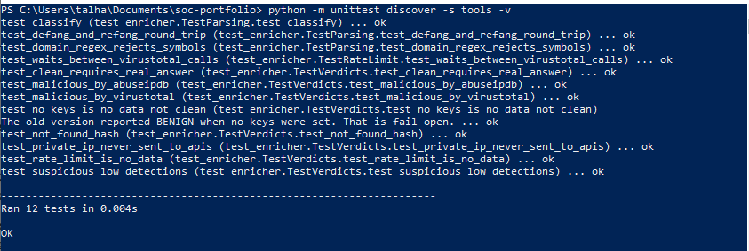

# Lab 06: Automated IOC Enrichment Tool (Python)

<div class="lab-meta" markdown>
**Category:** SOC Automation and Threat Intelligence<br>
**ATT&CK:** Supports triage across all tactics (enriches indicators from any investigation)<br>
**Built with:** Python 3, `requests`, VirusTotal API v3, AbuseIPDB API v2<br>
**Indicators:** IPv4 and IPv6 addresses, domains, MD5 / SHA1 / SHA256 hashes<br>
**Source code:** [`tools/enricher.py`](https://github.com/DesiKick/soc-analyst-portfolio/blob/main/tools/enricher.py) | **Tests:** [`tools/test_enricher.py`](https://github.com/DesiKick/soc-analyst-portfolio/blob/main/tools/test_enricher.py) (12 offline tests)
</div>

!!! success "Outcome: a working triage tool, tested and run on real indicators from my labs"
    The tool checks every indicator against two threat intelligence sources, assigns a verdict, defangs it, and writes a ticket-ready table. The results in section 5 are the tool's real output, generated from my own run.

!!! abstract "In plain English"
    **What this is:** When an alert fires, an analyst usually has a handful of suspicious IP addresses, website names, and file fingerprints to check. Normally that means pasting each one into several websites by hand. I wrote a program that does all of those lookups at once and writes up the answer.

    **Why it matters:** Manual lookups are slow and easy to get wrong, and they happen on almost every alert. Automating them gives the analyst more time for the actual decision.

    **What I did:** Built the tool in Python, wrote 12 automated tests for its logic, and ran it against real indicators from Labs 03 and 04, plus two control indicators to prove it can tell good from bad.

    **Result:** A ticket-ready report in seconds per indicator. Building and testing it also exposed a dangerous bug in my first version, which I fixed (section 3).

**Skills this lab shows:** `Python` `REST APIs` `VirusTotal` `AbuseIPDB` `Regex` `Defanging` `Unit testing` `Secure secret handling`

??? info "Key terms in this lab"
    - **IOC (indicator of compromise):** a clue such as a malicious IP address, domain, or file hash
    - **Threat intelligence:** shared knowledge about known-bad indicators
    - **API:** a way for one program to ask another for data
    - **Defanging:** rewriting an indicator so it cannot be clicked by accident, like `bad[.]com`
    - **Fail closed:** when data is missing, assume "unknown", never "safe"

    Every term is explained in the [Glossary](../foundations/glossary.md).

---

## 1. The Problem

For almost every alert, an analyst repeats the same manual steps:

1. Copy the IPs, domains, and hashes out of the alert.
2. Paste each one into VirusTotal, then paste the IPs into AbuseIPDB.
3. Decide from the scores whether each indicator is bad.
4. Defang everything before pasting it into the ticket, so nobody clicks a live malicious link.
5. Type the findings into the ticket.

None of these steps needs human judgment. All of them take time. That makes them the right thing to automate.

---

## 2. How the Tool Works

<div class="flow">
  <div><strong>1. Read</strong><span>Indicators from the command line or a file. Defanged input is accepted.</span></div>
  <div><strong>2. Classify</strong><span>IP, private IP, domain, or hash, using Python's ipaddress module and regex.</span></div>
  <div><strong>3. Look up</strong><span>VirusTotal for everything, AbuseIPDB for public IPs.</span></div>
  <div><strong>4. Decide</strong><span>Apply the verdict rules below.</span></div>
  <div><strong>5. Report</strong><span>Defang and write a Markdown table for the ticket.</span></div>
</div>

### Verdict rules

| Verdict | Rule |
| :--- | :--- |
| **MALICIOUS** | 5 or more VirusTotal engines flag it, or AbuseIPDB confidence is 75% or higher |
| **SUSPICIOUS** | Any VirusTotal detection, or AbuseIPDB confidence of 25% or higher |
| **CLEAN** | At least one source answered, and nothing was flagged |
| **NOT FOUND** | VirusTotal has never seen it. Common for brand-new phishing domains, so this is not a clean bill of health |
| **NO DATA** | No source answered: missing key, rate limit, or error |
| **INTERNAL** | Private IP address. Never sent to external services |

### Design decisions

| Decision | Why |
| :--- | :--- |
| API keys come from environment variables | Keys never appear in the code, the command history, or GitHub |
| Private IPs are never looked up | Sending internal addresses to outside services leaks information about the network, and the lookup is meaningless anyway |
| 15-second wait between VirusTotal calls | The free tier allows 4 requests per minute. Without the wait, later results fail silently |
| Defanged input is accepted | Analysts often copy indicators out of tickets that are already defanged |

```python
def verdict_for(vt: dict, ab: dict) -> str:
    """Fail closed: CLEAN only when a source answered and nothing was flagged."""
    vt_mal = vt.get("malicious", 0) if vt.get("ok") else 0
    vt_sus = vt.get("suspicious", 0) if vt.get("ok") else 0
    ab_score = ab.get("score", 0) if ab.get("ok") else 0
    if vt_mal >= VT_MALICIOUS or ab_score >= ABUSE_MALICIOUS:
        return "MALICIOUS"
    if vt_mal > 0 or vt_sus > 0 or ab_score >= ABUSE_SUSPICIOUS:
        return "SUSPICIOUS"
    answered = (vt.get("ok") and vt.get("found")) or ab.get("ok")
    if answered:
        return "CLEAN"
    if vt.get("ok") and vt.get("found") is False:
        return "NOT FOUND"
    return "NO DATA"
```

---

## 3. The Bug I Found and Fixed

My first version had a **fail-open** bug. When I ran it without API keys, it could not reach either service, and still marked every indicator **BENIGN**, including a known malicious domain.


In a real SOC this is dangerous. If a key expires or a service goes down, the tool would quietly tell analysts that malicious indicators are safe.

**Three more issues found in the same review:**

| Issue | Fix |
| :--- | :--- |
| The domain regex `[a-zA-Z0-9-_]` treated `9-_` as a character range, so it accepted symbols like `:` and `@` | Reordered to `[a-zA-Z0-9_-]`, with a test that rejects `bad:host.com` |
| Private IPs were sent to external APIs | Now classified as INTERNAL and never queried |
| No rate-limit handling for VirusTotal's free tier | 15-second delay between calls, and a rate-limited response becomes NO DATA |

Each fix has a matching automated test, so the bugs cannot come back unnoticed.

---

## 4. Test Set

Real indicators from earlier labs, plus two controls to prove the tool can tell good from bad:

| Indicator | Where it came from | What I expect |
| :--- | :--- | :--- |
| `7234C8F9...147D14C3` (SHA256) | [Lab 03](lab-03-splunk-lsass.md): binary that opened LSASS 38 times | Known to VirusTotal if the sample was ever submitted |
| `sultanbogor[.]com` | [Lab 04](lab-04-phishing-analysis.md): sender domain in the PayPal lure | Possibly flagged |
| `musacombi[.]online` | [Lab 04](lab-04-phishing-analysis.md): sender domain in the Netflix lure | Possibly flagged, or expired |
| `devret[.]xyz` | [Lab 04](lab-04-phishing-analysis.md): tracking pixel host | Possibly flagged |
| `192[.]168[.]10[.]45` | [Lab 05](lab-05-sentinel-bruteforce.md): simulated attacker IP | INTERNAL, never sent out |
| `8[.]8[.]8[.]8` | Control: Google public DNS | CLEAN |
| `185[.]220[.]101[.]5` | Control: public IP from abuse feeds | MALICIOUS or SUSPICIOUS |

---

## 5. Results

Command, run in my own PowerShell session with my API keys set:

```powershell
python tools\enricher.py --lab-set -o evidence\lab-06\report.md
```



**The generated report, exactly as the tool wrote it:**

--8<-- "evidence/lab-06/report.md"

Phishing infrastructure is short-lived, so domains from Lab 04 may come back NOT FOUND or CLEAN today even though they were malicious when the emails were sent. That is a real limit of reputation lookups, and why an analyst still reads the context.

---

## 6. Automated Tests

```powershell
python -m unittest discover -s tools -v
```



| Test covers | Example |
| :--- | :--- |
| Classification | `192.168.10.45` is private, `devret.xyz` is a domain, `bad:host.com` is rejected |
| Fail closed | No keys or a rate limit gives NO DATA, never CLEAN |
| Verdicts | 9 VirusTotal detections give MALICIOUS, 2 give SUSPICIOUS |
| Privacy | A private IP makes zero API calls |
| Rate limiting | Three VirusTotal lookups wait twice, 15 seconds each |

The tests use fake API responses, so they run in under a second without keys or internet.

---

## 7. Where This Fits in a SOC

The same logic is what a SOAR playbook runs automatically when an alert fires:

<div class="flow">
  <div><strong>Alert fires</strong><span>The SIEM raises an alert with indicators attached.</span></div>
  <div><strong>Enrich</strong><span>The playbook runs these lookups for every indicator.</span></div>
  <div><strong>Score</strong><span>Verdict rules decide the priority.</span></div>
  <div><strong>Route</strong><span>Clean results go to low priority; malicious ones page an analyst.</span></div>
  <div><strong>Document</strong><span>The table is attached to the ticket automatically.</span></div>
</div>

At Voya I built Python automation on the same idea, which cut 15-minute manual investigations to 15-second automated actions. This tool is a public, simplified version of that pattern.

---

## 8. Limits and Next Steps

- **Reputation is not a verdict.** A domain registered yesterday has no history. NOT FOUND means unknown, not safe.
- **Two sources only.** Next: add URLScan for URLs and WHOIS registration age, since a domain under 30 days old is a strong phishing signal.
- **Next lab:** [Lab 10](index.md) uses this tool to enrich the C2 domains found in a real malware PCAP.

---

## 9. Takeaways

- **Fail closed.** Missing data should never look like a clean result. My first version got this wrong.
- **Test the logic, not just the happy path.** The regex and fail-open bugs only showed up because I wrote tests for edge cases.
- **Protect secrets and internal data.** Keys stay in environment variables, and private IPs never leave the network.
