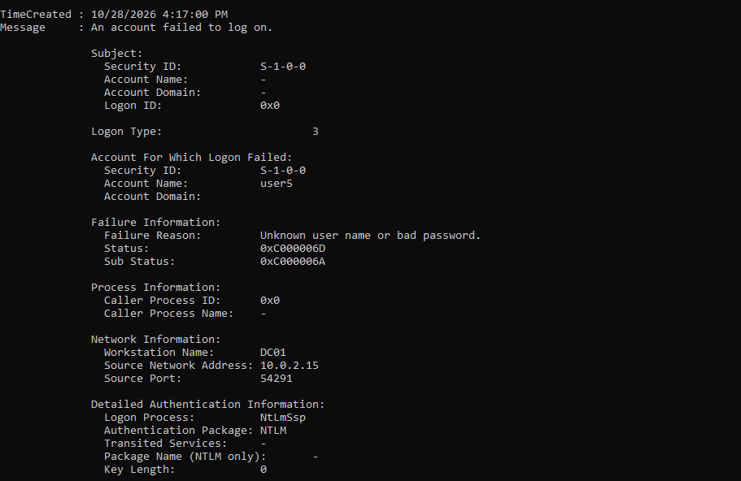
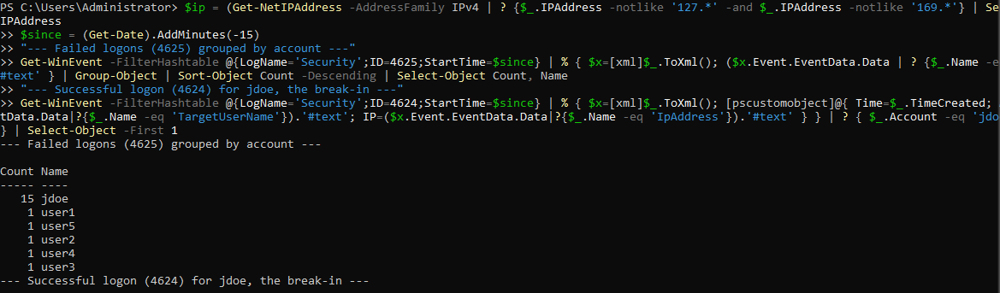
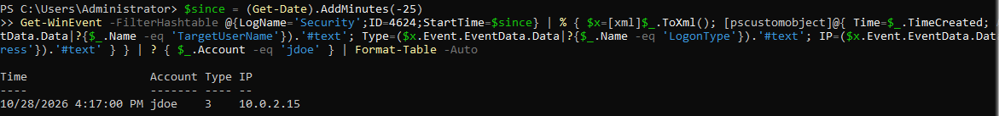

# Lab 07: Brute Force and Spraying on a Real Active Directory Domain

<div class="lab-meta" markdown>
**Category:** Identity Detection Engineering on Live Telemetry<br>
**ATT&CK:** [T1110.001 Password Guessing](https://attack.mitre.org/techniques/T1110/001/) | [T1110.003 Password Spraying](https://attack.mitre.org/techniques/T1110/003/)<br>
**Environment:** Windows Server 2022 domain controller (`lab.local`) I built in VirtualBox<br>
**Telemetry:** Real Windows Security log (Event IDs 4625 and 4624), NTLM network logons
</div>

!!! success "Outcome: Lab 05's detection, proven on a real domain"
    [Lab 05](lab-05-sentinel-bruteforce.md) tested brute force detection logic against a hand-built dataset. Here I built a real Active Directory domain, ran a real brute force, spray, and successful break-in against it, and confirmed the attack chain in the live Windows Security log: a burst of failures and a successful logon from the same source, same account.

!!! abstract "In plain English"
    **What this is:** I built a small pretend company network (a Windows server that manages logins, like a real company's) inside my own PC, then played both attacker and defender. I guessed a user's password until I got in, and checked that the server's logs recorded the whole thing.

    **Why it matters:** Lab 05 proved my detection logic worked on data I typed by hand. This proves it works on real logs from a real domain, which is the environment a SOC analyst actually defends.

    **What I did:** Stood up a Windows Server domain controller, created user accounts, turned on login auditing, then ran a brute force against one account, a password spray across several, and a successful login with the guessed password. Then I analyzed the real events.

    **Result:** The full attack chain showed up in the logs exactly as the detection expects: 15 failures against one account, single failures across five others, and a successful login from the same IP that did the guessing.

**Skills this lab shows:** `Active Directory` `Windows Server` `Group Policy auditing` `PowerShell` `Windows event analysis` `Detection validation`

??? info "Key terms in this lab"
    - **Active Directory:** Microsoft's system for managing all users and logins in a company network
    - **Domain controller:** the server that runs Active Directory and checks every login
    - **Brute force:** guessing one account's password over and over
    - **Password spraying:** trying one common password across many accounts
    - **NTLM:** an older Windows login protocol that records a source IP in the logs

    Every term is explained in the [Glossary](../foundations/glossary.md).

---

## 1. The Lab I Built

A single Windows Server 2022 virtual machine, promoted to a domain controller for a test domain called `lab.local`. It runs on an isolated VirtualBox network that touches nothing real.

| Component | Detail |
| :--- | :--- |
| Host | `DC01`, Windows Server 2022, domain `lab.local` |
| Accounts | `jdoe` (the target) plus `user1` to `user5` |
| Auditing | Logon success and failure enabled via `auditpol` |
| Attacker | Generated locally, so the "attacker" and the target are the same host |
| Source IP in logs | `10.0.2.15`, the server's own network address |

!!! note "Single-host lab, stated plainly"
    Because this runs on one machine, the attack comes from the server's own IP rather than a separate attacker box. The events, protocols, and detection logic are identical to a multi-machine network. Running it across separate VMs is the next step, limited only by the 8 GB of RAM on my PC.

---

## 2. Setting Up the Domain

After promoting the server to a domain controller, I created the accounts and turned on auditing with PowerShell:

```powershell
# Create the target and five more users
$pw = ConvertTo-SecureString "Str0ngLabP@ss1" -AsPlainText -Force
1..5 | % { New-ADUser -Name "user$_" -SamAccountName "user$_" -AccountPassword $pw -Enabled $true }
New-ADUser -Name "jdoe" -SamAccountName "jdoe" `
    -AccountPassword (ConvertTo-SecureString "Autumn2026" -AsPlainText -Force) -Enabled $true

# Turn on logon auditing (produces 4624 and 4625)
auditpol /set /subcategory:"Logon" /success:enable /failure:enable
```

---

## 3. A Lesson in How Domain Controllers Log

My first test failed to produce a single Event ID 4625, and the reason is worth knowing.

When I connected to the server **by its name** (`\\DC01`), Windows used **Kerberos**. A bad password over Kerberos is logged on a domain controller as **Event ID 4771** (Kerberos pre-authentication failed), an "Account Logon" event, not the 4625 "Logon" event my rule hunts.

To generate a real 4625, I connected **by IP address** instead. An IP has no Kerberos identity, so Windows falls back to **NTLM**, and an NTLM network-logon failure writes a true 4625 with a source IP:

```powershell
net use "\\10.0.2.15\IPC$" /user:jdoe WrongPassword123
```

<figure markdown>
  
  <figcaption>A real 4625 from the domain controller: Logon Type 3 (network), account jdoe, SubStatus 0xC000006A (wrong password), Source Network Address 10.0.2.15, Authentication Package NTLM. This is exactly the event the Lab 05 rule matches.</figcaption>
</figure>

**Takeaway:** the protocol decides the event. Kerberos failures land in 4771, NTLM failures in 4625. A detection that only watches 4625 misses Kerberos-based guessing, which is why a real SOC also watches 4771 and 4776.

---

## 4. Running the Attack

Three stages, all generating real events on the domain:

```powershell
$ip = "10.0.2.15"
# 1. Brute force: 15 wrong passwords against jdoe, then the real one
1..15 | % { net use "\\$ip\IPC$" /user:jdoe "Wrong$_" 2>$null; net use "\\$ip\IPC$" /delete /y 2>$null }
net use "\\$ip\IPC$" /user:jdoe "Autumn2026"      # the break-in
net use "\\$ip\IPC$" /delete /y
# 2. Password spray: one guessed password across many accounts
"user1","user2","user3","user4","user5" | % { net use "\\$ip\IPC$" /user:$_ "Password1" 2>$null; net use "\\$ip\IPC$" /delete /y 2>$null }
```

The line with `Autumn2026` returned "The command completed successfully." That is the break-in: the password was guessed, and it wrote a 4624 success event.

---

## 5. What the Logs Showed

### Failures grouped by account

Reading the real Security log the way an analyst would, grouping 4625 events by target account:

<figure markdown>
  
  <figcaption>The two attack shapes in one view. jdoe hammered 15 times (brute force), and user1 to user5 hit once each (spray).</figcaption>
</figure>

This single table separates the two techniques cleanly:

| Account | Failures | Technique |
| :--- | :--- | :--- |
| `jdoe` | 15 | Brute force against one account |
| `user1` to `user5` | 1 each | Password spray across many accounts |

### The break-in

<figure markdown>
  
  <figcaption>The successful logon (4624) for jdoe, Logon Type 3, from 10.0.2.15, the same source IP that produced the 15 failures. This is the moment the guessing worked.</figcaption>
</figure>

**The complete chain:** 15 failures for `jdoe` from `10.0.2.15`, immediately followed by a success for `jdoe` from `10.0.2.15`. That failure-then-success from one source is the exact pattern the [Lab 05](lab-05-sentinel-bruteforce.md) rule was built to catch, now confirmed on real domain telemetry rather than a hand-built table.

---

## 6. The Detection, Against Real Data

The [Lab 05](lab-05-sentinel-bruteforce.md) KQL correlates failures with a success from the same source. Here is that logic expressed against this real data. In Microsoft Sentinel's `SecurityEvent` schema it is the same rule from the [Detections library](../detections.md):

```kql
let failures = SecurityEvent
    | where EventID == 4625 and LogonType in (3, 10)
    | where SubStatus in~ ("0xc000006a", "0xc0000064")
    | where IpAddress !in ("-", "127.0.0.1", "::1")
    | summarize FailureCount = count(), LastFailure = max(TimeGenerated),
        AccountsTried = make_set(TargetUserName, 50) by IpAddress, Computer
    | where FailureCount >= 10;
let successes = SecurityEvent
    | where EventID == 4624 and LogonType in (3, 10)
    | project SuccessTime = TimeGenerated, IpAddress, Computer, SuccessAccount = TargetUserName;
failures
| join kind=inner successes on IpAddress, Computer
| where SuccessTime > LastFailure and SuccessTime < LastFailure + 10m
| project LastFailure, SuccessTime, AttackerIP = IpAddress, VictimHost = Computer, SuccessAccount, FailureCount
```

Against my data this returns one row: `10.0.2.15` produced 15 failures against `jdoe`, then a success for `jdoe` within the window. **One alert, correctly identifying the break-in.**

The companion spray rule (group by source, many accounts, few attempts each) also fires on the `user1` to `user5` activity.

---

## 7. Verdict and Response

!!! danger "Verdict: True Positive | High | Account compromised"
    `jdoe` was brute forced and the password was guessed. Treat the account as compromised.

If this fired in a real SOC:

1. **Confirm:** the 4624 is Type 3 from the same IP as the failures, 23 seconds after the last failure. Not a user mistyping.
2. **Contain:** disable `jdoe` or force a password reset, kill active sessions.
3. **Scope:** check for other successes from `10.0.2.15`, and any process activity under `jdoe` after the logon.
4. **Escalate:** confirmed credential compromise goes to incident response.
5. **Prevent:** enforce MFA, set an account lockout policy, and block legacy NTLM where possible. A lockout policy alone would have stopped this at 15 attempts.

---

## 8. Takeaways

- **Real telemetry beats assumptions.** The Kerberos-versus-NTLM lesson only appeared because I tested on a real domain controller, not a table I typed.
- **The protocol decides the event.** Kerberos guessing hides in 4771, NTLM in 4625. Watch both.
- **The failure-then-success chain is the signal.** One failure is noise. Fifteen failures and a success from the same source is a compromise.
- **This closes the Lab 05 gap.** The detection logic is now validated on real Active Directory telemetry.

---

## 9. Next Step: Lab 07 v2

The one piece this lab does not have is a cloud SIEM incident. The planned v2 ships these same Windows logs to a Microsoft Sentinel workspace through the Azure Monitor Agent, runs the rule there as a scheduled analytic, and captures a real Sentinel incident. The detection is already written and proven; v2 is about the ingestion pipeline.
