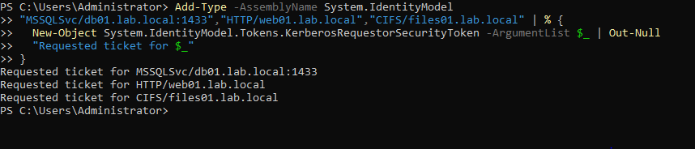
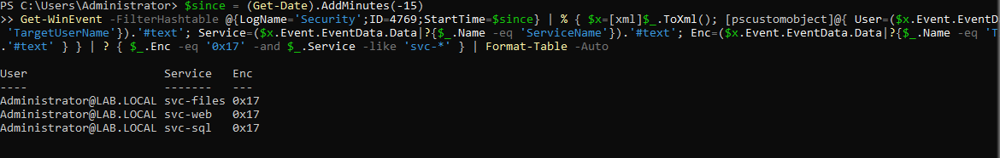

# Lab 08: Kerberoasting Detection on a Real AD Domain

<div class="lab-meta" markdown>
**Category:** Active Directory Detection Engineering<br>
**ATT&CK:** [T1558.003 Steal or Forge Kerberos Tickets: Kerberoasting](https://attack.mitre.org/techniques/T1558/003/)<br>
**Environment:** The `lab.local` Windows Server 2022 domain controller from [Lab 07](lab-07-ad-bruteforce.md)<br>
**Telemetry:** Real Windows Security log, Event ID 4769 (Kerberos service ticket requested)
</div>

!!! success "Outcome: a validated Kerberoasting detection on real domain telemetry"
    I created vulnerable service accounts, ran the Kerberoasting request pattern against my own domain, and detected it in the live Security log: one user pulling multiple service tickets with weak RC4 encryption. The ticket cracking that would follow happens offline and is out of scope; the detection is the point.

!!! abstract "In plain English"
    **What this is:** Some accounts in a Windows network run background services (a database, a website). Any logged-in user is allowed to ask for one of those accounts' login tickets, and that ticket is scrambled using the service account's password. If the account uses old, weak scrambling, an attacker can take the ticket away and guess the password at their own pace, offline, where no alarm can see them.

    **Why it matters:** This is one of the most common ways attackers escalate inside a Windows network, and it is quiet. The request for the ticket looks almost normal. The one tell is the weak encryption, and that is what a SOC watches for.

    **What I did:** Set up three service accounts configured with the weak encryption attackers look for, requested all their tickets at once (the "roast"), then detected the pattern in the logs.

    **Result:** The detection cleanly flagged one user requesting three service tickets, all with weak RC4 encryption, in seconds. On a healthy domain that almost never happens.

**Skills this lab shows:** `Active Directory` `Kerberos` `Service Principal Names` `Windows event analysis` `Detection engineering`

??? info "Key terms in this lab"
    - **Kerberos:** the system Windows domains use to prove who you are without sending your password around
    - **Service account:** an account that runs a background service rather than a person
    - **SPN (Service Principal Name):** the label that ties a service, like a database, to its service account
    - **Service ticket:** the Kerberos proof a user gets to talk to a service. It is encrypted with the service account's password
    - **RC4 vs AES:** two ways to scramble a ticket. RC4 is old and weak; AES is modern and strong. RC4 tickets are the ones worth stealing

    Every term is explained in the [Glossary](../foundations/glossary.md).

---

## 1. How Kerberoasting Works

```text
1. Attacker (any normal user) asks the domain controller for a service ticket
   to a service account's SPN.
2. The DC hands over a ticket encrypted with that service account's password.
3. If the account allows RC4, the ticket is weakly encrypted.
4. The attacker takes the ticket offline and guesses the password at leisure.
   No further alarms, because the cracking never touches the network.
```

The attacker never needs admin rights to request the ticket. That is what makes it dangerous, and why the request itself is the only moment a defender can catch it.

---

## 2. The Vulnerable Setup

I created three service accounts, each tied to a service SPN, and deliberately set each to allow only **RC4** encryption. That weak setting is exactly what attackers hunt for, and it is common in real networks where old applications never got upgraded.

```powershell
$sp = ConvertTo-SecureString "Summer2024!" -AsPlainText -Force
New-ADUser -Name "svc-sql"   -SamAccountName "svc-sql"   -AccountPassword $sp -Enabled $true -ServicePrincipalNames "MSSQLSvc/db01.lab.local:1433"
New-ADUser -Name "svc-web"   -SamAccountName "svc-web"   -AccountPassword $sp -Enabled $true -ServicePrincipalNames "HTTP/web01.lab.local"
New-ADUser -Name "svc-files" -SamAccountName "svc-files" -AccountPassword $sp -Enabled $true -ServicePrincipalNames "CIFS/files01.lab.local"

# Force RC4 only (msDS-SupportedEncryptionTypes = 4). This is the weakness.
"svc-sql","svc-web","svc-files" | % { Set-ADUser -Identity $_ -Replace @{"msDS-SupportedEncryptionTypes"=4} }

# Make sure service-ticket requests are audited (produces 4769)
auditpol /set /subcategory:"Kerberos Service Ticket Operations" /success:enable /failure:enable
```

---

## 3. The Roast

Requesting a service ticket is a normal Kerberos operation, done here with a built-in .NET class, no attack tools:

```powershell
Add-Type -AssemblyName System.IdentityModel
"MSSQLSvc/db01.lab.local:1433","HTTP/web01.lab.local","CIFS/files01.lab.local" | % {
  New-Object System.IdentityModel.Tokens.KerberosRequestorSecurityToken -ArgumentList $_ | Out-Null
  "Requested ticket for $_"
}
```

<figure markdown>
  
  <figcaption>Three service tickets requested in seconds. Each one writes an Event ID 4769.</figcaption>
</figure>

Each request wrote a **4769**. Three service tickets pulled in seconds by one account is the roasting shape. What an attacker does next, taking the tickets offline to crack, never touches the domain, so this request is the defender's one chance to see it.

---

## 4. The Detection

The signal is **Event ID 4769 with RC4 encryption (type 0x17) for service accounts**. On a modern domain almost every ticket is AES (0x12), so RC4 service-ticket requests stand out. Reading the real log:

```powershell
$since = (Get-Date).AddMinutes(-15)
Get-WinEvent -FilterHashtable @{LogName='Security';ID=4769;StartTime=$since} | % {
  $x=[xml]$_.ToXml()
  [pscustomobject]@{
    User    = ($x.Event.EventData.Data|?{$_.Name -eq 'TargetUserName'}).'#text'
    Service = ($x.Event.EventData.Data|?{$_.Name -eq 'ServiceName'}).'#text'
    Enc     = ($x.Event.EventData.Data|?{$_.Name -eq 'TicketEncryptionType'}).'#text'
  }
} | ? { $_.Enc -eq '0x17' -and $_.Service -like 'svc-*' } | Format-Table -Auto
```

<figure markdown>
  
  <figcaption>One user (Administrator) requested tickets for all three service accounts, every one with encryption type 0x17 (RC4). That is the Kerberoasting signature.</figcaption>
</figure>

| User | Service | Encryption | Meaning |
| :--- | :--- | :--- | :--- |
| `Administrator@LAB.LOCAL` | `svc-sql` | `0x17` (RC4) | Roastable ticket requested |
| `Administrator@LAB.LOCAL` | `svc-web` | `0x17` (RC4) | Roastable ticket requested |
| `Administrator@LAB.LOCAL` | `svc-files` | `0x17` (RC4) | Roastable ticket requested |

### The detection in KQL (Sentinel)

The same logic for the Sentinel `SecurityEvent` table, in the [Detections library](../detections.md):

```kql
SecurityEvent
| where EventID == 4769
| where TicketEncryptionType == "0x17"            // RC4, the weak, crackable type
| where ServiceName !endswith "$" and ServiceName != "krbtgt"
| where TicketOptions != "0x40810000"             // drop common benign patterns after tuning
| summarize TicketCount = count(), Services = make_set(ServiceName, 50),
    FirstSeen = min(TimeGenerated), LastSeen = max(TimeGenerated)
    by Account, IpAddress
| where TicketCount >= 3                            // one user, several RC4 service tickets quickly
| order by TicketCount desc
```

---

## 5. Verdict and Response

!!! danger "Verdict: True Positive | High | Likely credential theft in progress"
    One account requested RC4 service tickets for three service accounts in seconds. That is Kerberoasting, and those service-account passwords should be considered at risk.

Response steps:

1. **Confirm:** check whether the requesting user legitimately needs those services. A normal user almost never requests MSSQL, HTTP, and CIFS service tickets at once.
2. **Contain:** reset the passwords of the targeted service accounts (`svc-sql`, `svc-web`, `svc-files`), using long, random passwords.
3. **Scope:** look for the same user requesting other RC4 tickets, and watch those service accounts for logons in the next days, which would mean a crack succeeded.
4. **Escalate:** confirmed Kerberoasting goes to incident response.

### The real fix: remove the weakness

1. **Disable RC4** for these accounts (`msDS-SupportedEncryptionTypes = 24`, AES only). A ticket an attacker cannot crack quickly is far less useful.
2. **Use long, random service-account passwords** (25+ characters), which make offline cracking impractical even over RC4.
3. **Consider Group Managed Service Accounts**, which rotate their own 120-character passwords automatically.

After forcing AES, the same roast produces 0x12 tickets, and this detection correctly goes quiet.

---

## 6. Takeaways

- **The request is the only alarm.** The cracking is offline and silent, so a SOC has to catch the RC4 ticket request or it never sees the attack at all.
- **Encryption type is the signal.** RC4 (0x17) service tickets on a modern domain are abnormal. AES (0x12) is normal.
- **No admin rights needed.** Any user can Kerberoast, which is why service-account hygiene (AES, long passwords, gMSA) matters so much.
- **This closes a coverage gap.** Kerberos credential access is now validated on my real domain, alongside the brute force work in [Lab 07](lab-07-ad-bruteforce.md).
