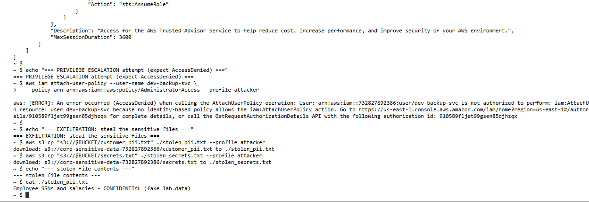
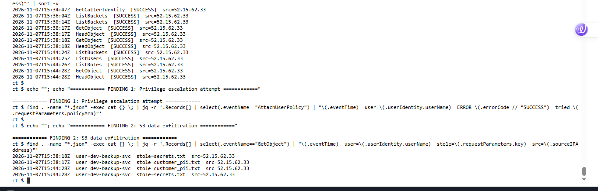
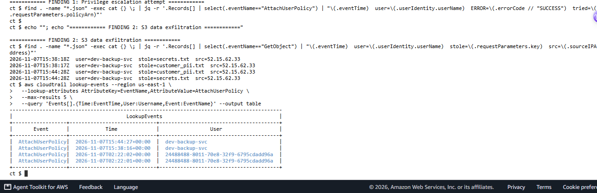
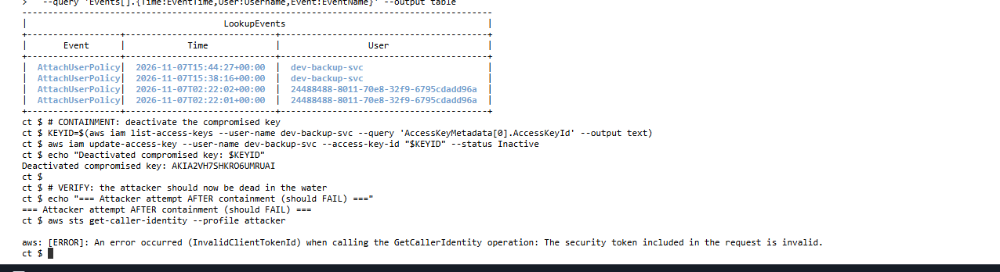

# Lab 09: Compromised IAM Key - Detection & Incident Response in AWS

<div class="lab-meta" markdown>
**Category:** Cloud Security / Incident Response<br>
**ATT&CK:** [T1078.004 Valid Accounts: Cloud](https://attack.mitre.org/techniques/T1078/004/) · [T1087 Account Discovery](https://attack.mitre.org/techniques/T1087/) · [T1098 Account Manipulation](https://attack.mitre.org/techniques/T1098/) · [T1530 Data from Cloud Storage](https://attack.mitre.org/techniques/T1530/)<br>
**Environment:** My own AWS account, CloudTrail (multi-region), region `us-east-2`<br>
**Telemetry:** Real CloudTrail logs - management events + S3 object-level data events
</div>

!!! success "Outcome: a full cloud incident, reconstructed from logs alone"
    I simulated a leaked IAM access key, ran the classic AWS breach chain against my own account (recon, privilege escalation, data theft from S3), then put on the defender hat and rebuilt the entire attack timeline from CloudTrail, contained the key, and wrote the response runbook. Everything below is real telemetry from my account.

!!! abstract "In plain English"
    **What this is:** In AWS, an "access key" is a long password that lets code talk to the cloud. These keys leak constantly (pasted in code, committed to GitHub, left on a laptop). This lab shows what an attacker does with a leaked key, and how a defender catches it using the cloud's own audit log.

    **Why it matters:** A leaked key is the single most common way AWS environments get breached. The attacker does not "hack" anything - they log in with a valid key and act like a trusted user. The only way to catch them is to spot behavior that does not fit.

    **What I did:** Planted fake sensitive data in cloud storage, created a limited "service account" key and treated it as leaked, used it to look around, try to grant itself admin, and steal the data. Then I investigated it exactly as I would a real incident.

    **Result:** I reconstructed the whole attack from CloudTrail - the reconnaissance, the failed admin-escalation attempt, and the two files stolen - all tied to one suspicious IP, then disabled the key and confirmed the attacker was locked out.

**Skills this lab shows:** `AWS` `CloudTrail` `Incident Response` `IAM` `S3` `Log analysis (jq)` `Cloud detection engineering` `MITRE ATT&CK (cloud)`

??? info "Key terms in this lab"
    - **IAM:** AWS's identity system - users, roles, and the permissions attached to them.
    - **Access key:** a long-lived credential (an ID + secret) used to call AWS programmatically. The thing that leaks.
    - **CloudTrail:** AWS's audit log. Records every API call in the account. The cloud equivalent of Windows Security event logs.
    - **Management events vs data events:** management events are control-plane actions (create a user, attach a policy). Data events are object-level actions (read a specific S3 file). You must enable data events to see file theft.
    - **S3:** AWS object storage ("buckets"). Where the sensitive data lived.
    - **Global vs regional services:** IAM is global and only logs to `us-east-1`. A single-region trail cannot see it. This bit me, and it is a real lesson below.

---

## 1. The attack chain

A leaked IAM key almost always follows the same four steps. I reproduced each one.

```text
1. VALID ACCESS   - Attacker authenticates with the leaked key (looks legitimate).
2. RECON          - Lists buckets, users, and roles to map the environment.
3. ESCALATION     - Tries to attach AdministratorAccess to itself. (Denied here.)
4. EXFILTRATION   - Downloads the sensitive files from S3.
```

The attacker never exploits a vulnerability. They use a trusted credential and behave abnormally. That behavior is the only detection surface.

<figure markdown>
  
  <figcaption>The leaked key in action: recon succeeds, the AdministratorAccess attach returns <code>AccessDenied</code>, and both "sensitive" files download.</figcaption>
</figure>

---

## 2. The environment

Built entirely in my own account, torn down afterward:

- **CloudTrail** enabled and writing to a dedicated log bucket, with **S3 object-level data events** turned on for the target bucket (so file reads are logged, not just control-plane actions).
- An **S3 bucket** holding two fake "confidential" files (`customer_pii.txt`, `secrets.txt`).
- A limited IAM user, `dev-backup-svc`, with `AmazonS3ReadOnlyAccess` and `IAMReadOnlyAccess`. Its access key is the credential I treated as leaked. Deliberately **not** an admin, so the escalation attempt would be denied and generate a high-value signal.

---

## 3. The investigation

With only the leaked key's name to go on, I pulled every CloudTrail log and reconstructed the attack with `jq`. The behavioral pattern was unmistakable.

<figure markdown>
  
  <figcaption>The full timeline for <code>dev-backup-svc</code>, rebuilt from raw CloudTrail logs: recon, then escalation, then theft, all from one IP.</figcaption>
</figure>

**The reconstructed kill chain:**

| Time (UTC) | API call | Meaning | ATT&CK |
| :--- | :--- | :--- | :--- |
| 15:44:24 | `ListBuckets` | Find the data | T1580 |
| 15:44:25 | `ListUsers` | Map identities | T1087 |
| 15:44:26 | `ListRoles` | Map privilege | T1087 |
| 15:44:27 | `AttachUserPolicy` -> **AccessDenied** | Self-escalate to admin | T1098 |
| 15:44:28 | `GetObject` x2 | Steal `customer_pii.txt`, `secrets.txt` | T1530 |

All activity originated from a single source IP, `52.15.62.33` - a backup service account enumerating IAM and granting itself admin from one address. No legitimate service does that.

<figure markdown>
  
  <figcaption>The two smoking guns: the S3 <code>GetObject</code> exfiltration (from data events) and the denied <code>AttachUserPolicy</code> escalation (from CloudTrail Event history).</figcaption>
</figure>

---

## 4. Two lessons this lab taught me

!!! warning "Lesson 1: A single-region trail is blind to IAM"
    My first investigation was missing the recon and the escalation entirely. The cause: **IAM is a global service and only logs to `us-east-1`**, but my trail was single-region in `us-east-2`. A real analyst who built their trail this way would never see an attacker enumerate or escalate IAM. The fix is a **multi-region trail with global service events enabled**. After that change, the full chain appeared.

!!! tip "Lesson 2: Event history is the backstop"
    While my trail's delivery lagged, I confirmed the `AttachUserPolicy` escalation instantly using CloudTrail **Event history** - the always-on, 90-day record that exists independent of any trail. Good practice: use the trail for deep and data events, and Event history for a fast, cross-region confirmation.

---

## 5. The detection

The signal is **behavioral**, not signature-based. The highest-fidelity single indicator is a non-admin principal (especially a service account) attempting privilege escalation and getting denied.

### Near-real-time: EventBridge rule

An EventBridge rule on CloudTrail management events, fired to an SNS topic to page the SOC:

```json
{
  "source": ["aws.iam"],
  "detail": {
    "eventName": ["AttachUserPolicy", "AttachRolePolicy", "PutUserPolicy", "CreateAccessKey"],
    "errorCode": ["AccessDenied", "Client.UnauthorizedOperation"]
  }
}
```

### Hunt / correlation: CloudTrail Lake or Athena (SQL)

```sql
SELECT eventtime, useridentity.username, eventname, errorcode, sourceipaddress
FROM cloudtrail_logs
WHERE useridentity.type = 'IAMUser'
  AND (
       (eventname IN ('AttachUserPolicy','AttachRolePolicy','PutUserPolicy','CreateAccessKey')
        AND errorcode = 'AccessDenied')
    OR eventname IN ('ListUsers','ListRoles','GetAccountAuthorizationDetails')
    OR (eventname = 'GetObject' AND requestparameters LIKE '%sensitive%')
  )
ORDER BY eventtime;
```

The strongest correlation: one principal doing **IAM discovery + a denied escalation + S3 object reads** inside a short window, from an unusual IP. That combination is the compromised-key fingerprint.

---

## 6. Verdict and response

!!! danger "Verdict: True Positive | Critical | Compromised credential with confirmed data exfiltration"
    A limited service account performed IAM reconnaissance, attempted to self-escalate to AdministratorAccess, and successfully read two sensitive objects from S3, all from a single external IP. The key must be considered fully compromised and the data breached.

**Incident response runbook (what I did, and what follows):**

1. **Detect** - alert on the denied escalation from a service account.
2. **Analyze** - pull the CloudTrail timeline for the principal, establish blast radius (this key had S3 read and IAM read), and confirm exfiltration via the `GetObject` data events.
3. **Contain** - **deactivate the access key immediately** (done in the lab; the attacker's next call failed with `InvalidClientTokenId`). Disable rather than delete, to preserve forensics.
4. **Eradicate** - delete the key, rotate any secrets it could have read, and hunt for persistence (new keys, new users, new roles the attacker may have created).
5. **Recover** - reissue the service with a fresh, least-privilege credential (ideally a short-lived IAM role instead of a long-lived key), and restore normal operations.
6. **Lessons learned** - the fixes below.

<figure markdown>
  
  <figcaption>Containment: the compromised key is deactivated, and the attacker's next call dies with <code>InvalidClientTokenId</code>. The stolen credential is now useless.</figcaption>
</figure>

---

## 7. Takeaways

- **Long-lived access keys are the number-one AWS breach vector.** Prefer short-lived IAM roles; if keys are unavoidable, rotate them and scope them tightly.
- **CloudTrail must be multi-region** or you are blind to IAM, STS, and other global-service activity.
- **Enable S3 data events** on sensitive buckets, or object-level theft is invisible.
- **A denied privilege-escalation from a service account is a high-fidelity signal.** Alert on it directly.
- **Detection in the cloud is behavioral.** The attacker holds a valid credential; you catch them by what the credential does, not by a malware signature. This is the core of AWS Security Incident Response.
