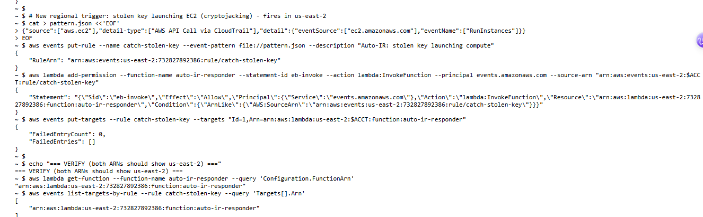
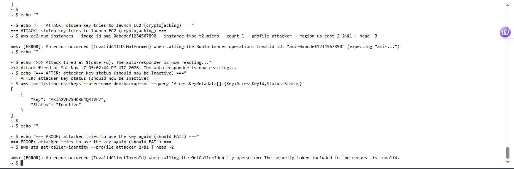
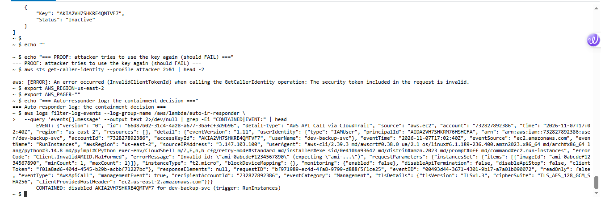

# Lab 10: Automated Incident Response - Auto-Containing a Stolen Key

<div class="lab-meta" markdown>
**Category:** Cloud Security / Detection Engineering / Automation (SOAR)<br>
**ATT&CK:** [T1078.004 Valid Accounts: Cloud](https://attack.mitre.org/techniques/T1078/004/) · [T1496 Resource Hijacking](https://attack.mitre.org/techniques/T1496/)<br>
**Environment:** My own AWS account, region `us-east-2`<br>
**Stack:** EventBridge, Lambda (Python), CloudTrail, IAM
</div>

!!! success "Outcome: an attack detected and contained in under two minutes, with no human involved"
    I built an automated incident-response pipeline in AWS: EventBridge watches for a stolen key misbehaving, and the instant it does, a Lambda function automatically disables that key. I then attacked it with a leaked credential and watched the key get killed on its own. This is the automation layer on top of the manual investigation from [Lab 09](lab-09-aws-iam-compromise.md).

!!! abstract "In plain English"
    **What this is:** In [Lab 09](lab-09-aws-iam-compromise.md) I caught a stolen AWS key by reading logs after the fact. That is slow, an attacker can do a lot of damage before an analyst notices. This lab makes the response **automatic**: the moment a stolen key does something suspicious, the system disables it by itself, in seconds, 24/7, no analyst needed.

    **Why it matters:** The number-one thing attackers do with a stolen AWS key is spin up expensive servers to mine cryptocurrency. Every minute counts. Automated containment turns a response time of "whenever someone notices" into "a few seconds."

    **What I did:** Built a rule that watches for a key trying to launch servers, wired it to a small program (a Lambda function) that disables the key, then played the attacker and watched my own defense shut me down.

    **Result:** The stolen key tried to launch EC2 compute. Within about a minute, the key was automatically disabled and the attacker was locked out, confirmed in the logs with no human action.

**Skills this lab shows:** `AWS` `EventBridge` `Lambda` `Python` `CloudTrail` `IAM` `Security automation (SOAR)` `Detection engineering`

??? info "Key terms in this lab"
    - **EventBridge:** AWS's event router. It watches for things happening and can trigger an action when a pattern matches.
    - **Lambda:** code that runs on demand with no server to manage. Here it is the "robot analyst" that disables the key.
    - **CloudTrail:** AWS's audit log; it feeds the API-call events EventBridge watches.
    - **SOAR:** Security Orchestration, Automation and Response, using automation to handle incidents instead of doing every step by hand.
    - **Cryptojacking:** stealing cloud compute to mine cryptocurrency. The classic payoff for a stolen AWS key.

---

## 1. The problem with manual response

In [Lab 09](lab-09-aws-iam-compromise.md) I detected a stolen key by investigating CloudTrail after the attack. That works, but it depends on a human noticing. An attacker with a stolen key can enumerate, escalate, and launch resources within seconds. The fix is to **remove the human from the containment step** for high-confidence signals.

---

## 2. The pipeline

```text
  Attacker (stolen key)  --- tries to launch EC2 (cryptojacking) --->  AWS API
                                                                          |
                                                 CloudTrail records the RunInstances call
                                                                          |
                                      EventBridge rule matches the event pattern
                                                                          |
                                           Lambda "auto-ir-responder" fires
                                                                          |
                                   Disables the offending user's access keys
                                                                          |
                                   Attacker's next call fails. Contained.
```

Three moving parts: a **CloudTrail**-fed event stream, an **EventBridge rule** that recognizes the attack, and a **Lambda** that does the containment.

---

## 3. The responder (Lambda)

The function reads the event, finds the user behind the API call, and disables their access keys. It has a safety allow-list so it can never lock out a protected account.

```python
import json, boto3
iam = boto3.client('iam')
PROTECTED = {"admin", "root"}  # safety: never auto-disable these

def handler(event, context):
    detail = event.get("detail", {})
    user = (detail.get("userIdentity") or {}).get("userName")
    trigger = detail.get("eventName", "unknown")
    if not user or user in PROTECTED:
        return {"status": "skipped"}
    disabled = []
    for k in iam.list_access_keys(UserName=user)["AccessKeyMetadata"]:
        iam.update_access_key(UserName=user, AccessKeyId=k["AccessKeyId"], Status="Inactive")
        disabled.append(k["AccessKeyId"])
        print(f"CONTAINED: disabled {k['AccessKeyId']} for {user} (trigger: {trigger})")
    return {"status": "contained", "user": user, "disabled_keys": disabled, "trigger": trigger}
```

The Lambda's execution role is scoped to just what it needs: `iam:ListAccessKeys`, `iam:UpdateAccessKey`, and CloudWatch Logs. Least privilege applies to the responder too.

---

## 4. The trigger (EventBridge)

The rule matches a stolen key's most likely move: trying to launch compute.

```json
{
  "source": ["aws.ec2"],
  "detail-type": ["AWS API Call via CloudTrail"],
  "detail": {
    "eventSource": ["ec2.amazonaws.com"],
    "eventName": ["RunInstances"]
  }
}
```

<figure markdown>
  
  <figcaption>The rule <code>catch-stolen-key</code> wired to the <code>auto-ir-responder</code> Lambda, both confirmed in the same region.</figcaption>
</figure>

---

## 5. The test: attack vs automation

Acting as the attacker with a leaked key, I tried to launch an EC2 instance. The key was `Active` before. Within about a minute, with no human action, it was `Inactive`.

<figure markdown>
  
  <figcaption>The stolen key attempts <code>RunInstances</code>, then its status flips to <code>Inactive</code> on its own, and the attacker's next call fails with <code>InvalidClientTokenId</code>.</figcaption>
</figure>

The responder logged its own decision, proof the automation, not an analyst, did the containment:

<figure markdown>
  
  <figcaption>The Lambda's log: it received the <code>RunInstances</code> event for <code>dev-backup-svc</code> and disabled the key.</figcaption>
</figure>

```text
CONTAINED: disabled AKIA...QMTVF7 for dev-backup-svc (trigger: RunInstances)
```

---

## 6. Two lessons this lab taught me

!!! warning "Lesson 1: AWS_REGION overrides AWS_DEFAULT_REGION"
    My first build silently landed in the wrong region because CloudShell sets `AWS_REGION`, which takes precedence over the `AWS_DEFAULT_REGION` I had set. An EventBridge rule in the wrong region would never fire, a silent failure, the worst kind. I now pin **both** variables and verify the ARNs before trusting a pipeline.

!!! tip "Lesson 2: Service Control Policies can restrict by region"
    This account's SCP allowed Lambda and EventBridge in `us-east-2` but explicitly denied them in `us-east-1`. Combined with the fact that IAM is a global service (events only in `us-east-1`), I had to design the trigger around a **regional** signal (EC2 `RunInstances`) that the governance policy actually permitted. Real cloud security means building within the guardrails you are given.

---

## 7. Verdict and the automation's place

!!! danger "Verdict: True Positive | High | Stolen credential attempting resource hijacking, auto-contained"
    A service account with no EC2 permissions attempted to launch instances, a strong indicator of a compromised key being used for cryptojacking. The automated responder disabled the credential before any compute was launched.

**Where automation fits in incident response:** automated containment is powerful but must be used only on **high-confidence** signals, with a safety allow-list, so it never disrupts legitimate work. A service account suddenly trying to launch EC2 is high-confidence. For lower-confidence signals you alert a human instead. The judgment of *what* to automate is the security-engineering skill; the Lambda is just the hands.

---

## 8. Takeaways

- **Automated containment turns response time from minutes or hours into seconds**, which for a stolen key can be the difference between a non-event and a large bill or breach.
- **Automate only high-confidence signals, and always include a safety allow-list.** A responder that locks out legitimate users is worse than none.
- **Least privilege applies to the responder**, not just to users. The Lambda can disable keys and nothing else.
- **Verify region and guardrails first.** `AWS_REGION` precedence and region-scoped SCPs can silently break a pipeline.
- This is the **SOAR layer** on top of [Lab 09](lab-09-aws-iam-compromise.md): detect, then respond automatically. Together they cover the full AWS incident-response loop.
